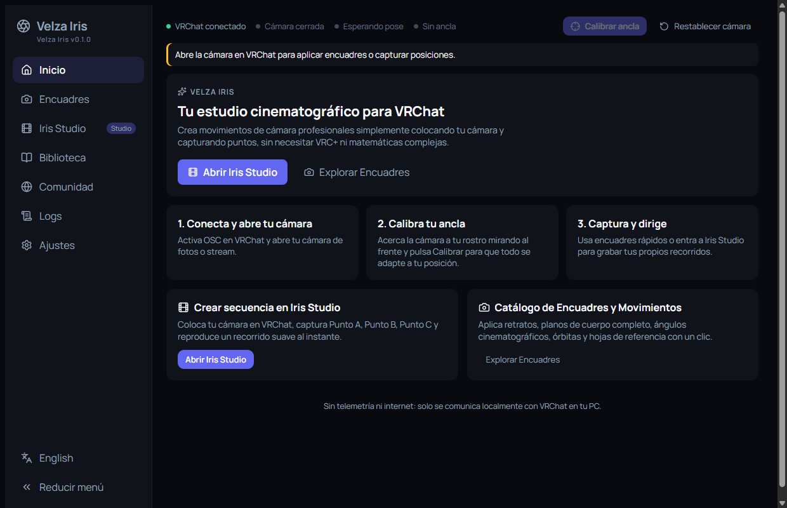
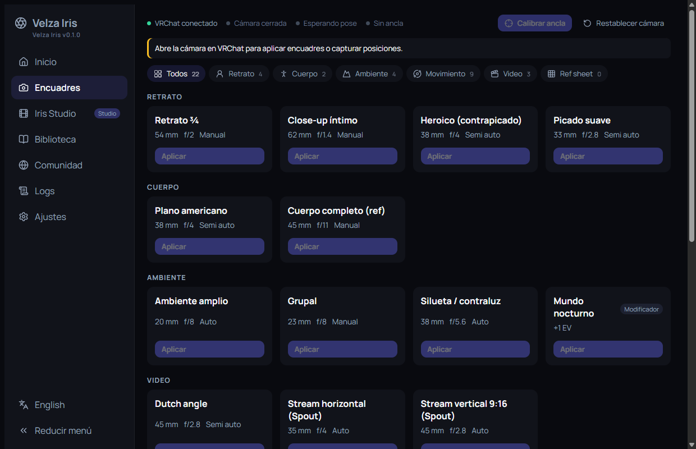
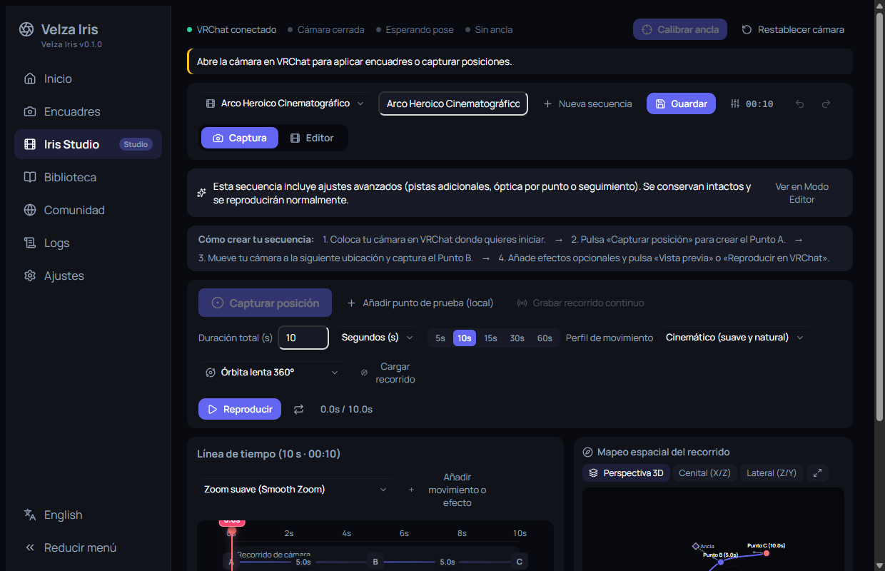
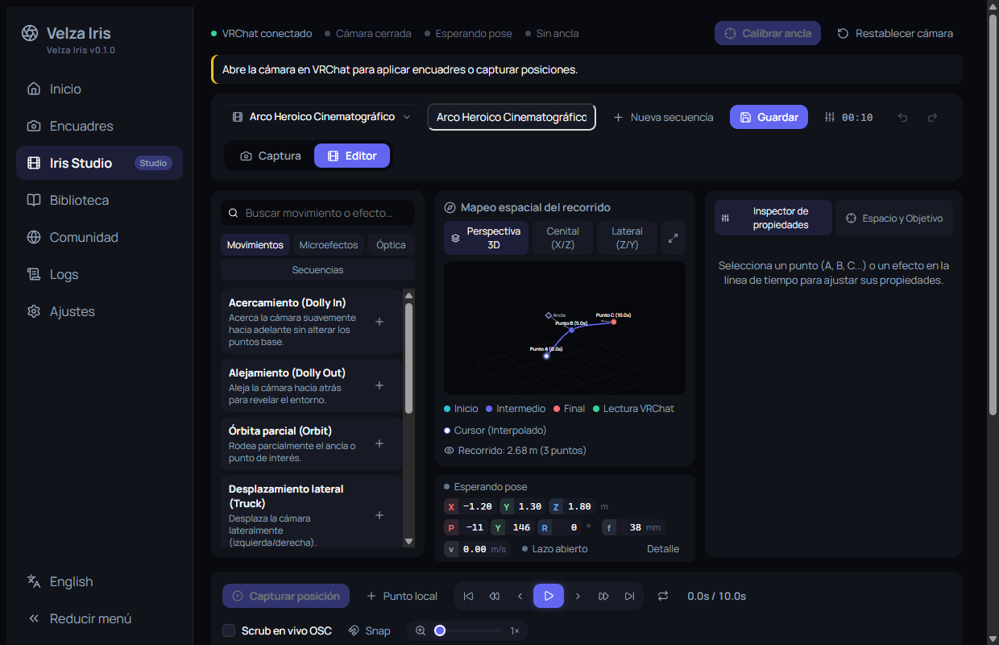
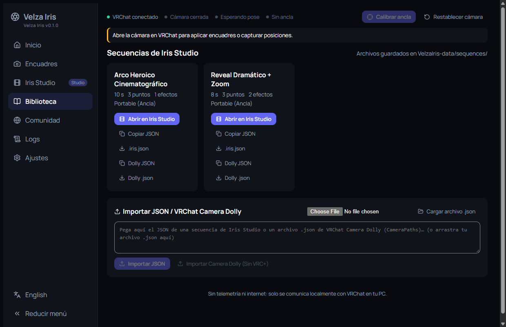

<div align="center">

# 🎥 Velza Iris

**Tu estudio cinematográfico para VRChat.**
Controla la cámara oficial de VRChat por OSC: encuadres, movimientos y secuencias, sin VRC+ ni matemáticas 3D.

🇲🇽 Español · [🇺🇸 English](README.en.md)



</div>

---

## ✨ Características

- 📸 **Encuadres:** catálogo de retratos, planos de cuerpo, ambiente y video (zoom, apertura, exposición y enfoque) listos para aplicar con un clic.
- 🌀 **Movimientos predefinidos:** órbitas, hélice, push-in, pull-out, crane, dolly zoom y handheld, además de **Turnaround** para hojas de referencia.
- 🎬 **Iris Studio:** crea secuencias capturando puntos (A, B, C…) o grabando un recorrido continuo; edítalas con línea de tiempo, efectos, curvas y vista espacial 3D.
- 📚 **Biblioteca:** guarda, abre, importa y exporta secuencias en JSON, con soporte de **VRChat Camera Dolly**.
- 🧭 **Relativo al jugador:** calibra un ancla y tus encuadres y secuencias funcionan en cualquier mundo.
- 🕺 **Visualizador de avatar:** gizmo de cámara y path de 5 huesos dentro de VRChat (requiere el prefab de Unity; ver [`docs/avatar-visualizer.md`](docs/avatar-visualizer.md)).
- 🌐 **Español e inglés**, tema oscuro/claro y color de acento a elegir.
- 🔒 **Portable y sin telemetría:** no usa internet; solo habla con VRChat en tu PC.

## 📸 Capturas

| Encuadres | Iris Studio · Captura |
| :---: | :---: |
|  |  |
| **Iris Studio · Editor** | **Biblioteca** |
|  |  |

> Capturas tomadas con VRChat abierto pero la cámara cerrada, por eso aparece el aviso amarillo.

## 📦 Descarga (portable)

1. Descarga el `.zip` más reciente (`VelzaIris-vX.Y.Z-win-x64-portable.zip`) desde la sección de **Releases**.
2. Descomprímelo donde quieras y ejecuta `velza-iris.exe`. No hay instalador.
3. Tus datos se guardan en `VelzaIris-data/`, junto al `.exe` (o en `%LOCALAPPDATA%` si lo eliges en Ajustes). Para actualizar, reemplaza solo el `.exe` y conserva esa carpeta.

**Requisitos:** Windows 10/11 de 64 bits, Microsoft Edge WebView2 (incluido en Windows 11) y VRChat con OSC habilitado.

## 🚀 Cómo se usa

1. 🎮 En VRChat, activa OSC en **Menú de acción → Opciones → OSC → Activado**.
2. 📷 Abre la cámara de VRChat (Velza Iris no puede abrirla por ti).
3. ▶️ Ejecuta `velza-iris.exe`. Arriba verás **VRChat conectado** y **Cámara abierta**.
4. 🎯 Acerca la cámara a tu rostro, mirando al frente, muévela un poco y pulsa **Calibrar ancla**. Recalibra después de teletransportarte.
5. 🖼️ Entra a **Encuadres** para aplicar un plano o movimiento, o a **Iris Studio** para crear tu propia secuencia: captura el Punto A, muévete, captura el Punto B y pulsa **Reproducir en VRChat**.

Guía completa paso a paso: [`docs/user_guide.es.md`](docs/user_guide.es.md).

## 🛠️ Tecnologías

| Capa | Tecnología |
| --- | --- |
| Aplicación de escritorio | [Tauri 2](https://tauri.app) |
| Backend | Rust (edición 2024) · [`rosc`](https://crates.io/crates/rosc) (OSC) · [`mdns-sd`](https://crates.io/crates/mdns-sd) (OSCQuery/mDNS) · `serde` / `serde_json` |
| Interfaz | [Svelte 5](https://svelte.dev) + [SvelteKit](https://svelte.dev/docs/kit) (`adapter-static`) · TypeScript |
| Build | [Vite](https://vite.dev) · [pnpm](https://pnpm.io) |
| UI | [Lucide](https://lucide.dev) (íconos) · Manrope (tipografía) · i18n propio (`es-MX` / `en`) |
| Protocolo | OSC sobre UDP (envío a `9000`, escucha en `9001`) y OSCQuery de VRChat |

## ⌨️ Comandos

Desde la raíz del repositorio, en PowerShell. Necesitas Node.js, pnpm, Rust y Cargo.

| Comando | Uso |
| --- | --- |
| `pnpm install` | Instala las dependencias de la interfaz. |
| `pnpm tauri dev` | Inicia la app de escritorio en modo desarrollo. |
| `pnpm dev` | Servidor de desarrollo web de Vite (sin conexión OSC). |
| `pnpm check` | Revisa tipos y componentes Svelte. |
| `pnpm test:i18n` | Verifica que `es-MX.json` y `en.json` estén sincronizados y sin textos sueltos. |
| `pnpm test:logs` | Pruebas de la vista de Logs. |
| `pnpm build` | Compila la interfaz web (`build/`). |
| `pnpm tauri build --no-bundle` | Genera el ejecutable de release en `src-tauri/target/release/velza-iris.exe`. |

El empaquetado de Tauri está desactivado (`bundle.active: false`), así que no se genera instalador: el portable es el `.exe` comprimido en un `.zip`.

### 🔎 Sonda OSC (`tools/probe`)

Herramienta de línea de comandos para descubrir OSCQuery, escuchar y enviar mensajes OSC:

```powershell
cargo run --manifest-path tools/probe/Cargo.toml -- tree
cargo run --manifest-path tools/probe/Cargo.toml -- listen
cargo run --manifest-path tools/probe/Cargo.toml -- send /usercamera/Zoom 45
cargo run --manifest-path tools/probe/Cargo.toml -- rate 60 10
```

| Subcomando | Uso |
| --- | --- |
| `tree [host:puerto]` | Busca VRChat por mDNS y guarda el árbol de `/usercamera` en `docs/oscquery-usercamera.json`. |
| `listen [puerto]` | Escucha `/usercamera/*` en UDP 9001 y guarda logs en `tools/probe/logs/`. |
| `send /usercamera/ENDPOINT VALOR [--to host:puerto]` | Envía un mensaje OSC (`true`/`false` booleano, `i:N` entero, número decimal, o texto). |
| `rate HZ SEGUNDOS [RADIO]` | Envía una órbita de prueba y mide los ecos de Pose (radio por defecto: `0.1` m). |

> ⚠️ `send` cambia ajustes reales de la cámara y `rate` la mueve. Abre la cámara antes y cierra otras apps OSC que usen UDP 9001.

## 🗂️ Estructura del proyecto

```
src/                  Interfaz (SvelteKit)
  routes/             Vistas principales
  lib/studio/         Iris Studio (timeline, editor, viewport 3D)
  lib/i18n/           Diccionarios es-MX / en
src-tauri/src/        Backend Rust
  osc/ camera/        Protocolo OSC/OSCQuery y control de la cámara
  motion/ studio/     Movimientos, secuencias, grabación y reproducción
  avatar/ anchor/     Visualizador de avatar y calibración del ancla
  presets/ storage/   Encuadres y datos portables
tools/                Sonda OSC y scripts de verificación
docs/                 Guías y hallazgos técnicos
```

## 🔒 Datos locales y privacidad

Velza Iris no usa telemetría ni conexión a internet: se comunica con VRChat por OSC/OSCQuery dentro de tu red local. Presets, secuencias y ajustes se guardan en `VelzaIris-data/` junto al ejecutable (o en `%LOCALAPPDATA%\VelzaIris-data`). Las preferencias de tema e idioma se guardan en el WebView de la app.

## 📚 Documentación

- 📖 [Guía de usuario (español)](docs/user_guide.es.md) · [User guide (English)](docs/user_guide.en.md)
- 🔬 [`docs/osc-findings.md`](docs/osc-findings.md): hallazgos y pruebas de OSC.
- 🕺 [`docs/avatar-visualizer.md`](docs/avatar-visualizer.md): visualizador de avatar.

## 📄 Licencia

Distribuido bajo la licencia [GNU GPL v3.0](LICENSE). Puedes usar, estudiar, modificar y compartir Velza Iris, pero cualquier versión modificada que distribuyas debe seguir siendo software libre bajo la misma licencia.

> La versión `v0.1.0` se publicó antes del cambio de licencia y quien la descargó la conserva bajo MIT; el código desde este cambio está bajo GPL-3.0.
