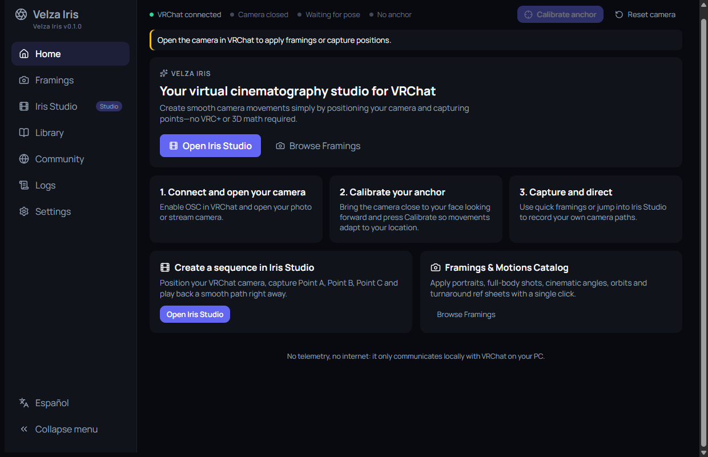
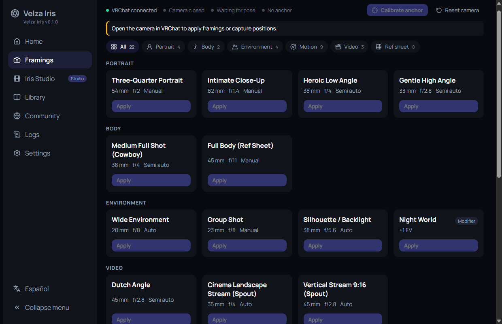
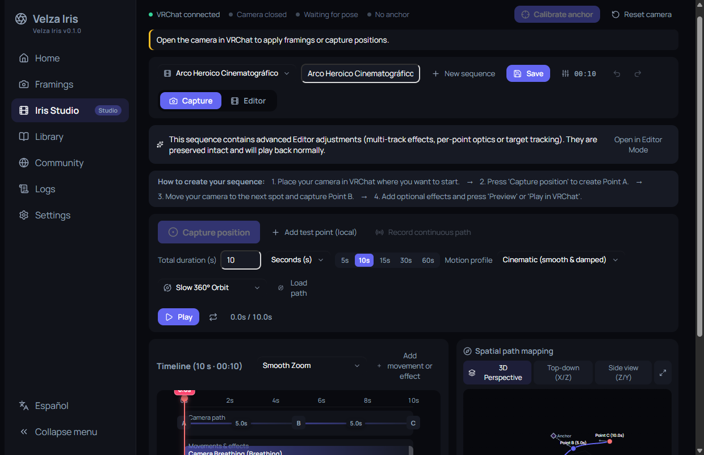
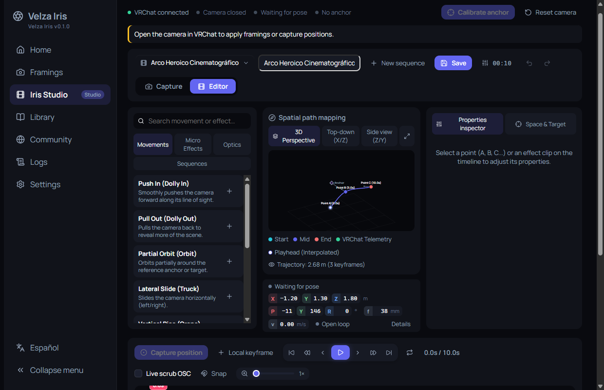
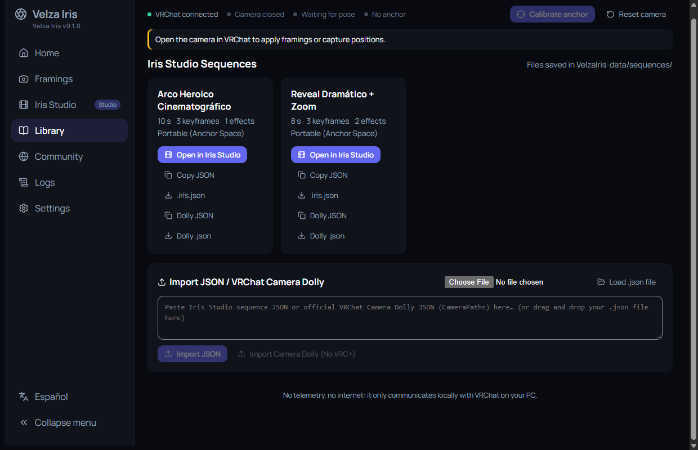
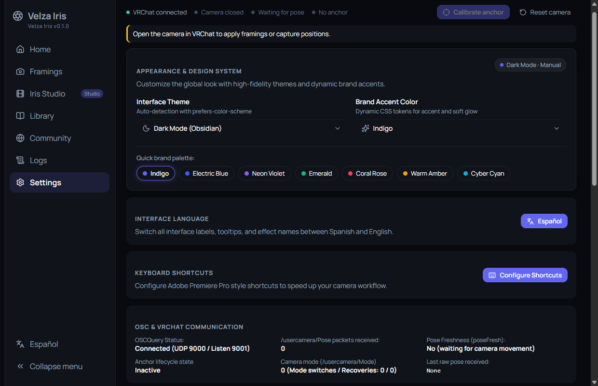
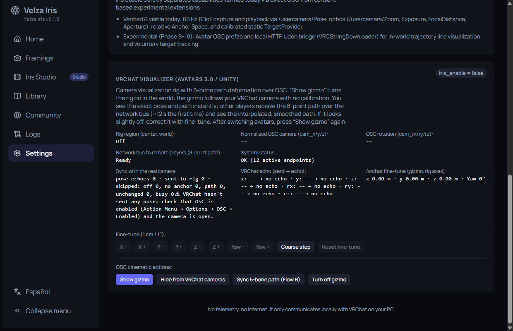

# 📖 Velza Iris User Guide

[🇲🇽 Español](user_guide.es.md) · 🇺🇸 English · [⬅️ Back to README](../README.en.md)

Velza Iris controls VRChat's official camera over OSC. Use it to apply framings, run automatic motions and build camera sequences by capturing points, with no VRC+ and no 3D math.

## 📑 Contents

1. [Requirements](#-requirements)
2. [Portable install](#-portable-install)
3. [Connecting to VRChat](#-connecting-to-vrchat)
4. [Calibrating the anchor](#-calibrating-the-anchor)
5. [Home](#-home)
6. [Framings and motions](#-framings-and-motions)
7. [Iris Studio](#-iris-studio)
8. [Library](#-library)
9. [Logs](#-logs)
10. [Settings](#-settings)
11. [Keyboard shortcuts](#-keyboard-shortcuts)
12. [Troubleshooting](#-troubleshooting)
13. [Data and privacy](#-data-and-privacy)

---

## ✅ Requirements

- 64-bit Windows 10 or 11.
- Microsoft Edge WebView2 (included in Windows 11; it may be missing on Windows 10).
- VRChat with **OSC enabled**.

## 📦 Portable install

1. Download `VelzaIris-vX.Y.Z-win-x64-portable.zip` from **Releases** and extract it to a writable folder. Nothing needs to be installed.
2. Run `velza-iris.exe`.
3. **Updating:** close the app and replace only `velza-iris.exe`. Keep the `VelzaIris-data/` folder so you don't lose your sequences and framings.
4. **Uninstalling:** delete the app folder. If you chose `%LOCALAPPDATA%` in Settings, also delete `%LOCALAPPDATA%\VelzaIris-data`.

## 🎮 Connecting to VRChat

1. Open VRChat and enable OSC under **Action Menu → Options → OSC → Enabled**.
2. Open VRChat's **camera** (photo or stream camera). Velza Iris can't open it over OSC.
3. Run `velza-iris.exe`. It connects by itself through OSCQuery.

The top bar shows four indicators:

| Indicator | Meaning |
| --- | --- |
| **VRChat connected** / *Looking for VRChat…* | Whether the app found VRChat over OSC. |
| **Camera open** / *closed* | Whether VRChat's camera is open. |
| **Pose ready** / *Waiting for pose* | Whether VRChat is already reporting the camera position. Nudge the camera to get it started. |
| **Anchor calibrated** / *No anchor* | Whether you've calibrated your anchor (see below). |

If something is missing, a yellow notice under the bar tells you what to do. At the top right, **Reset camera** restores zoom, exposure, focus, aperture, speeds and toggles to VRChat's defaults.

## 🎯 Calibrating the anchor

The **anchor** is your reference position. With it, framings and sequences apply **relative to you** and work in any world.

1. With the camera open, bring it close to your face looking forward.
2. Nudge it slightly so VRChat sends its position.
3. Press **Calibrate anchor**.

Recalibrate every time you teleport or change worlds. Automatic motions require the camera to be open **and** the anchor calibrated.

## 🏠 Home

A summary of the flow (connect and open your camera → calibrate → capture and direct) with shortcuts to **Iris Studio** and **Framings**.

## 📸 Framings and motions

The **Framings** view is a catalog you can filter by category: **Portrait, Body, Environment, Motion, Video** and **Ref sheet**. Each card shows focal length, aperture and focus mode. Press **Apply** to send it to VRChat's camera. Framings that set a camera position need a calibrated anchor; those tagged **Modifier** only change one parameter (for example +1 EV for dark worlds).

### Automated motions

The **Automated motions** panel (in the same view) launches built-in moves: slow 360° orbit, ¾ ping-pong arc, helical rise, push-in, pull-out reveal, crane up, dolly zoom (Vertigo) and subtle handheld. It requires a connection, an open camera and a calibrated anchor.

- **Play / Pause / Resume / Stop** control the motion.
- **Speed**, **Loop** and **Reverse direction** adjust it.
- **Panic** stops everything immediately and returns to the last static framing.

### Turnaround (reference sheet)

Circles your avatar and captures photos at each stop, with a green background and no players or environment. Choose **8 views** or **4 views**. **Set VRChat's camera focus to Manual before starting.**

## 🎬 Iris Studio

Iris Studio is where you build your own sequences. It has two modes: **Capture** (fast) and **Editor** (full control).

### Capture mode

1. Place your camera in VRChat where you want to start.
2. Press **Capture position** to create **Point A**. If the app keeps waiting, nudge the camera slightly in VRChat.
3. Move the camera to the next spot and capture **Point B**; repeat for C, D…
4. Set the **Total duration** (with the 5 s, 10 s, 15 s, 30 s, 60 s buttons or by typing it) and the **Motion profile**:
   - **Cinematic:** smooth inertia and natural damping.
   - **Precision:** rigid response with zero overshoot.
   - **Organic:** subtle organic micro-variations.
5. Press **Preview** (shown inside the app, without touching VRChat) or **Play in VRChat** (moves the real camera).

More options:

- **Record continuous path:** move the camera freely while recording; Velza Iris turns the path into editable keyframes. Afterwards you can **Smooth / Reduce** keyframes.
- **Load path:** loads a built-in motion as an editable sequence.
- **Add test point (local):** adds a point without using the real camera.
- **New sequence:** choose **Blank** or the **Heroic arc template**; **Advanced settings** define the reference space, trajectory scale, calibration offsets and default looping.
- **Project settings:** change the duration (0.5 s to 60 min; also in MM:SS format). If you shorten it and items fall outside the new range, you can **clamp them to the new limit** or **scale all times proportionally**.
- **Save** sends the sequence to your Library. **Undo / Redo** sit next to the name.

### Editor mode

- **Catalog (left):** search and add **Movements** (dolly in/out, partial orbit, truck, crane, pan, tilt, reveal), **Micro Effects** (micro shake, impact, handheld, drift, breathing), **Optics** (smooth zoom, crash zoom, focus pull, aperture shift, dolly zoom) and **Sequences**.
- **Spatial path mapping (center):** your path in **3D Perspective**, **Top-down (X/Z)** or **Side view (Z/Y)**.
- **Inspector (right):** select a point or clip to edit position, rotation, focal length and smoothing between points. Under **Space & Target** you set the reference space and the target (the player's eyes or a static 3D point).
- **Timeline (bottom):** tracks for camera path, rotation, optics and effects. Drag points and clips, use **Snap** to magnetize and **Live scrub OSC** to move the real camera as you scrub.
- **Transition curves** between points are edited in the Bézier curve editor.

Sequences with advanced tracks, per-point optics or target tracking are preserved intact; press **Open in Editor Mode** to see them.

## 📚 Library

Lists your saved sequences (stored as files in `VelzaIris-data/sequences/`). For each one you can:

- **Open in Iris Studio.**
- **Copy JSON** or download **.iris.json** to share it.
- Export it as **Dolly JSON** / **Dolly .json**: the **VRChat Camera Dolly** format, with effects baked in.
- **Delete** it.

Under **Import JSON / VRChat Camera Dolly**, paste the JSON, or load or drag in a `.json` file, then press **Import JSON** or **Import Camera Dolly**.

The **Community** view is a preview: it will later let you browse `.iris` packs from other creators.

## 🧾 Logs

The **Logs** view shows OSC traffic and engine events in real time, useful for diagnosing issues. Filter by **All, OSC In, OSC Out, Engine** or **Errors**, search by address or value, and use **Pause**, **Clear** and **Copy**. **Collapse similar OSC packets** groups repeats into a single row with a counter (×N).

> ⚠️ Logs may include parameter names from your avatar. Review them before sharing.

## 🔧 Settings

- **Appearance:** theme (System, Dark, Light) and accent color.
- **Interface language:** English or Spanish (also via the button at the bottom of the side menu).
- **Keyboard shortcuts:** **Configure Shortcuts** opens the editor, with the Adobe Premiere Pro layout by default.
- **OSC & VRChat communication:** OSCQuery and pose status (handy to check whether VRChat is sending you data).
- **VRChat Visualizer:** controls the camera gizmo and 5-bone path inside VRChat. It needs an avatar with the Velza Iris prefab (see [`avatar-visualizer.md`](avatar-visualizer.md), in Spanish). **Show gizmo** turns it on, **Fine-tune** corrects it in 1 cm/1° steps (or 10 cm/10° with *Coarse step*), and **Sync 5-bone path** sends your path to other players.

## 🎹 Keyboard shortcuts

Defaults (changeable under **Settings → Configure Shortcuts**; press `?` to view them):

| Action | Shortcut |
| --- | --- |
| Play / Pause | `Space` |
| Shuttle backward · stop · forward | `J` · `K` · `L` |
| Previous / next frame (0.1 s) | `←` / `→` |
| Jump −1 s / +1 s | `Shift+←` / `Shift+→` |
| Previous / next keyframe | `↑` / `↓` |
| Go to start / end | `Home` / `End` |
| Capture / add keyframe | `C` |
| Selection tool | `V` |
| Copy · paste · duplicate | `Ctrl+C` · `Ctrl+V` · `Ctrl+D` |
| Delete selected | `Delete` |
| Toggle snap | `S` |
| Timeline zoom | `+` / `-` |
| View shortcuts | `?` |

## 🩺 Troubleshooting

| Message / symptom | Cause | What to do |
| --- | --- | --- |
| *No OSC connection to VRChat* / *Looking for VRChat…* | VRChat is closed or OSC is off. | Open VRChat and enable **Action Menu → Options → OSC → Enabled**. |
| *VRChat camera is closed* | The camera isn't open. | Open it in VRChat (the app can't do it for you). |
| *UDP listen port 9001 is unavailable* | Another OSC app is using port 9001. | Close that app and restart Velza Iris. Meanwhile it runs in *open-loop mode*, with no camera readout or calibration. |
| *No reference anchor calibrated* | You haven't calibrated. | Bring the camera to your face, nudge it and press **Calibrate anchor**. |
| *VRChat has not broadcasted camera pose yet* / *Waiting for pose* | VRChat hasn't sent the pose yet. | Nudge the camera slightly in-game. |
| *Nudge your camera in VRChat over the target…* | The target position hasn't been read yet. | Move the camera slightly over the target and capture again. |
| *Add at least one keyframe to the timeline* | The sequence is empty. | Capture at least one point before playing. |
| *Open camera in VRChat for live playback* | Playing in VRChat needs the camera open. | Open it, or use **Preview**. |
| *No camera movement was received during recording* | The camera didn't move while recording. | Move the camera in VRChat while recording. |
| *Stop the active motion or sequence before recalibrating* | A motion is running. | Stop it (or use **Panic**) and calibrate again. |
| *The received pose matches a commanded motion echo* | The position comes from a framing applied by the app, not from your hand. | Bring the camera close to your face and nudge it slightly. |
| Turnaround comes out blurry | Focus is on automatic. | Set VRChat's camera focus to **Manual**. |
| The visualizer gizmo is not visible | The avatar was reloaded or the prefab is missing. | Press **Resend gizmo**; confirm your avatar has the prefab. |

## 🔒 Data and privacy

- Velza Iris uses **no telemetry and no internet**: it only talks to VRChat on your PC (UDP 9000 to send, 9001 to listen, and OSCQuery over mDNS).
- Your data lives in `VelzaIris-data/` next to the `.exe` (or in `%LOCALAPPDATA%`, if you choose that in Settings). Back it up to keep your sequences.
- Theme and language are stored in the app's WebView.
