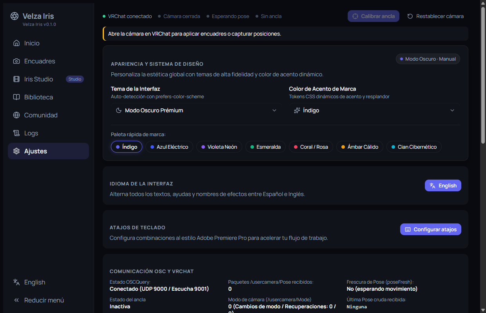
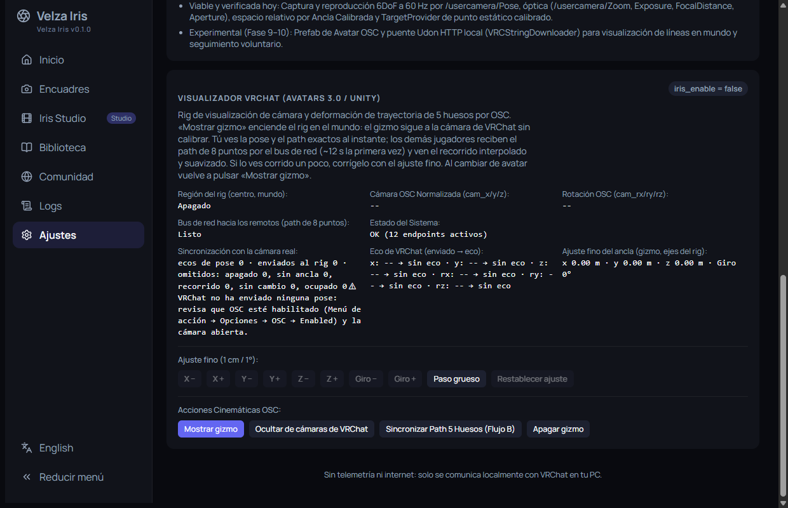

# 📖 Guía de usuario de Velza Iris

🇲🇽 Español · [🇺🇸 English](user_guide.en.md) · [⬅️ Volver al README](../README.md)

Velza Iris controla la cámara oficial de VRChat por OSC. Con ella aplicas encuadres, lanzas movimientos automáticos y creas secuencias de cámara capturando puntos, sin VRC+ ni matemáticas 3D.

## 📑 Contenido

1. [Requisitos](#-requisitos)
2. [Instalación portable](#-instalación-portable)
3. [Conectar con VRChat](#-conectar-con-vrchat)
4. [Calibrar el ancla](#-calibrar-el-ancla)
5. [Inicio](#-inicio)
6. [Encuadres y movimientos](#-encuadres-y-movimientos)
7. [Iris Studio](#-iris-studio)
8. [Biblioteca](#-biblioteca)
9. [Logs](#-logs)
10. [Ajustes](#-ajustes)
11. [Atajos de teclado](#-atajos-de-teclado)
12. [Solución de problemas](#-solución-de-problemas)
13. [Datos y privacidad](#-datos-y-privacidad)

---

## ✅ Requisitos

- Windows 10 u 11 de 64 bits.
- Microsoft Edge WebView2 (viene con Windows 11; en Windows 10 puede faltar).
- VRChat con **OSC habilitado**.

## 📦 Instalación portable

1. Descarga `VelzaIris-vX.Y.Z-win-x64-portable.zip` desde **Releases** y descomprímelo en una carpeta con permiso de escritura (no hace falta instalar nada).
2. Ejecuta `velza-iris.exe`.
3. **Actualizar:** cierra la app y reemplaza solo `velza-iris.exe`. Conserva la carpeta `VelzaIris-data/` para no perder tus secuencias y encuadres.
4. **Desinstalar:** borra la carpeta de la app. Si en Ajustes elegiste guardar en `%LOCALAPPDATA%`, borra también `%LOCALAPPDATA%\VelzaIris-data`.

## 🎮 Conectar con VRChat

1. Abre VRChat y activa OSC en **Menú de acción → Opciones → OSC → Activado**.
2. Abre la **cámara** de VRChat (cámara de fotos o de stream). Velza Iris no puede abrirla por OSC.
3. Abre `velza-iris.exe`. Se conecta sola mediante OSCQuery.

La barra superior muestra cuatro indicadores:

| Indicador | Significado |
| --- | --- |
| **VRChat conectado** / *Buscando VRChat…* | Si la app encontró VRChat por OSC. |
| **Cámara abierta** / *cerrada* | Si la cámara de VRChat está abierta. |
| **Pose lista** / *Esperando pose* | Si VRChat ya reporta la posición de la cámara. Muévela un poco para que empiece. |
| **Ancla calibrada** / *Sin ancla* | Si ya calibraste tu ancla (ver abajo). |

Si falta algo, un aviso amarillo debajo de la barra te dice qué hacer. Arriba a la derecha tienes **Restablecer cámara**, que devuelve zoom, exposición, enfoque, apertura, velocidades e interruptores a los valores por defecto de VRChat.

## 🎯 Calibrar el ancla

El **ancla** es tu posición de referencia. Con ella, encuadres y secuencias se aplican **relativos a ti** y sirven en cualquier mundo.

1. Con la cámara abierta, acércala a tu rostro mirando al frente.
2. Muévela ligeramente para que VRChat envíe su posición.
3. Pulsa **Calibrar ancla**.

Recalibra cada vez que te teletransportes o cambies de mundo. Los movimientos automáticos requieren cámara abierta **y** ancla calibrada.

## 🏠 Inicio

Resume el flujo (conecta y abre la cámara → calibra → captura y dirige) y tiene accesos directos a **Iris Studio** y a **Encuadres**.

## 📸 Encuadres y movimientos

La vista **Encuadres** tiene un catálogo filtrable por categoría: **Retrato, Cuerpo, Ambiente, Movimiento, Video** y **Ref sheet**. Cada tarjeta muestra la focal, la apertura y el modo de enfoque. Pulsa **Aplicar** para mandarlo a la cámara de VRChat. Los encuadres que mueven la cámara necesitan el ancla calibrada; los marcados como **Modificador** solo ajustan un parámetro (por ejemplo +1 EV para mundos oscuros).

### Movimientos automáticos

El panel **Movimientos automáticos** (en la misma vista) lanza recorridos predefinidos: órbita lenta 360°, arco ¾ de ida y vuelta, hélice, push-in, pull-out, crane up, dolly zoom (Vértigo) y handheld sutil. Requiere conexión, cámara abierta y ancla calibrada.

- **Reproducir / Pausar / Reanudar / Detener** controlan el movimiento.
- **Velocidad**, **Repetir** e **Invertir dirección** lo ajustan.
- **Pánico** detiene todo al instante y vuelve al último encuadre estático.

### Turnaround (hoja de referencia)

Gira alrededor de tu avatar y toma fotos en cada parada, con fondo verde y sin jugadores ni entorno. Elige **8 vistas** o **4 vistas**. **Antes de iniciar, pon el enfoque de la cámara de VRChat en Manual.**

## 🎬 Iris Studio

Iris Studio es donde creas secuencias propias. Tiene dos modos: **Captura** (rápido) y **Editor** (control total).

### Modo Captura

1. Coloca tu cámara en VRChat donde quieres empezar.
2. Pulsa **Capturar posición**: se crea el **Punto A**. Mueve ligeramente la cámara en VRChat si la app queda esperando la posición.
3. Mueve la cámara al siguiente lugar y captura el **Punto B**; repite para C, D…
4. Ajusta la **Duración total** (con los botones 5 s, 10 s, 15 s, 30 s, 60 s o escribiéndola) y el **Perfil de movimiento**:
   - **Cinemático:** inercia suave y amortiguación natural.
   - **Precisión:** respuesta rígida, sin sobreimpulso.
   - **Orgánico:** microvariaciones sutiles.
5. Pulsa **Vista previa** (se ve en la app, sin tocar VRChat) o **Reproducir en VRChat** (mueve la cámara real).

Otras opciones:

- **Grabar recorrido continuo:** mueve la cámara libremente mientras grabas; Velza Iris convierte el recorrido en puntos editables. Después puedes **Suavizar / Reducir** puntos.
- **Cargar recorrido:** carga un movimiento predefinido como secuencia editable.
- **Añadir punto de prueba (local):** agrega un punto sin usar la cámara real.
- **Nueva secuencia:** elige entre **En blanco** o **Plantilla arco heroico**; la **Configuración avanzada** define espacio de referencia, escala, offsets de calibración y repetición por defecto.
- **Configuración del proyecto:** cambia la duración (0.5 s a 60 min; también en formato MM:SS). Si recortas la duración y hay elementos fuera de rango, puedes **ajustarlos al nuevo límite** o **escalar todos los tiempos**.
- **Guardar** envía la secuencia a tu Biblioteca. **Deshacer / Rehacer** están junto al nombre.

### Modo Editor

- **Catálogo (izquierda):** busca y añade **Movimientos** (dolly in/out, órbita parcial, truck, crane, pan, tilt, reveal), **Microefectos** (microtemblor, impacto, handheld, deriva, respiración), **Óptica** (zoom suave, crash zoom, enfoque, apertura, dolly zoom) y **Secuencias**.
- **Mapeo espacial (centro):** tu recorrido en **Perspectiva 3D**, **Cenital (X/Z)** o **Lateral (Z/Y)**.
- **Inspector (derecha):** selecciona un punto o clip para editar posición, rotación, focal y suavizado entre puntos. En **Espacio y Objetivo** defines el espacio de referencia y el objetivo (los ojos del jugador o un punto 3D estático).
- **Línea de tiempo (abajo):** pistas de recorrido, rotación, óptica y efectos. Arrastra puntos y clips, usa **Snap** para imantar y **Scrub en vivo OSC** para mover la cámara real mientras recorres la línea.
- Las **curvas de transición** entre puntos se editan con el editor de curvas Bézier.

Las secuencias con pistas, óptica por punto o seguimiento avanzados se conservan intactas; pulsa **Ver en Modo Editor** para verlas.

## 📚 Biblioteca

Lista las secuencias guardadas (se guardan como archivos en `VelzaIris-data/sequences/`). En cada una puedes:

- **Abrir en Iris Studio.**
- **Copiar JSON** o descargar **.iris.json** para compartirla.
- Exportarla como **Dolly JSON** / **Dolly .json**: formato de **VRChat Camera Dolly**, con los efectos ya incorporados.
- **Eliminarla.**

En **Importar JSON / VRChat Camera Dolly** pega el JSON, o carga o arrastra un archivo `.json`, y pulsa **Importar JSON** o **Importar Camera Dolly**.

La vista **Comunidad** es un adelanto: más adelante permitirá explorar paquetes `.iris` de otros creadores.

## 🧾 Logs

La vista **Logs** muestra en tiempo real el tráfico OSC y los eventos del motor, útil para diagnosticar. Filtra por **Todo, OSC entrada, OSC salida, Motor** o **Errores**, busca por dirección o valor, y usa **Pausar**, **Limpiar** y **Copiar**. **Colapsar paquetes OSC similares** agrupa los repetidos en una fila con contador (×N).

> ⚠️ Los logs pueden incluir nombres de parámetros de tu avatar. Revísalos antes de compartirlos.

## 🔧 Ajustes

- **Apariencia:** tema (Sistema, Oscuro, Claro) y color de acento.
- **Idioma de la interfaz:** español o inglés (también con el botón de abajo en el menú lateral).
- **Atajos de teclado:** **Configurar atajos** abre el editor, con la distribución de Adobe Premiere Pro por defecto.
- **Comunicación OSC y VRChat:** estado de OSCQuery y de la pose (útil para saber si VRChat te está enviando datos).
- **Visualizador VRChat:** controla el gizmo de cámara y el path de 5 huesos dentro de VRChat. Requiere un avatar con el prefab de Velza Iris (ver [`avatar-visualizer.md`](avatar-visualizer.md)). **Mostrar gizmo** lo enciende, **Ajuste fino** lo corrige en pasos de 1 cm/1° (o 10 cm/10° con *Paso grueso*) y **Sincronizar Path 5 Huesos** envía tu recorrido a los demás jugadores.

## 🎹 Atajos de teclado

Valores por defecto (se pueden cambiar en **Ajustes → Configurar atajos**; presiona `?` para verlos):

| Acción | Atajo |
| --- | --- |
| Reproducir / Pausar | `Espacio` |
| Shuttle atrás · detener · adelante | `J` · `K` · `L` |
| Fotograma anterior / siguiente (0.1 s) | `←` / `→` |
| Saltar −1 s / +1 s | `Shift+←` / `Shift+→` |
| Keyframe anterior / siguiente | `↑` / `↓` |
| Ir al inicio / al final | `Inicio` / `Fin` |
| Capturar / añadir keyframe | `C` |
| Herramienta de selección | `V` |
| Copiar · pegar · duplicar | `Ctrl+C` · `Ctrl+V` · `Ctrl+D` |
| Eliminar selección | `Supr` |
| Activar/desactivar snap | `S` |
| Zoom de la línea de tiempo | `+` / `-` |
| Ver atajos | `?` |

## 🩺 Solución de problemas

| Mensaje / síntoma | Causa | Qué hacer |
| --- | --- | --- |
| *Sin conexión OSC con VRChat* / *Buscando VRChat…* | VRChat cerrado u OSC desactivado. | Abre VRChat y activa **Menú de acción → Opciones → OSC → Activado**. |
| *La cámara de VRChat está cerrada* | La cámara no está abierta. | Ábrela en VRChat (la app no puede hacerlo). |
| *Puerto de escucha UDP 9001 no disponible* | Otra app OSC usa el puerto 9001. | Cierra esa app y reinicia Velza Iris. Mientras tanto funciona en *modo control abierto*, sin lectura de cámara ni calibración. |
| *Sin ancla de referencia* | No has calibrado. | Acerca la cámara a tu rostro, muévela un poco y pulsa **Calibrar ancla**. |
| *VRChat aún no reporta la posición de la cámara* / *Esperando pose* | VRChat todavía no envió la pose. | Mueve ligeramente la cámara en el juego. |
| *Mueve ligeramente tu cámara en VRChat sobre el objetivo…* | Falta leer la posición del objetivo. | Mueve un poco la cámara sobre el objetivo y repite la captura. |
| *Agrega al menos un punto en la línea de tiempo* | La secuencia está vacía. | Captura al menos un punto antes de reproducir. |
| *Abre la cámara en VRChat para reproducir en vivo* | Reproducir en VRChat necesita la cámara abierta. | Ábrela, o usa **Vista previa**. |
| *No se recibieron movimientos de la cámara durante la grabación* | No se movió la cámara al grabar. | Mueve la cámara en VRChat mientras grabas. |
| *Detén el movimiento o secuencia activa antes de recalibrar* | Un movimiento está en curso. | Detenlo (o usa **Pánico**) y vuelve a calibrar. |
| *La pose recibida corresponde a un movimiento comandado* | La posición viene de un encuadre aplicado por la app, no de tu mano. | Acerca la cámara a tu rostro y muévela ligeramente. |
| El Turnaround sale desenfocado | El enfoque está en automático. | Pon el enfoque de la cámara de VRChat en **Manual**. |
| No se ve el gizmo del visualizador | El avatar se recargó o falta el prefab. | Pulsa **Reenviar gizmo**; confirma que tu avatar tiene el prefab. |

## 🔒 Datos y privacidad

- Velza Iris **no usa telemetría ni internet**: solo se comunica con VRChat en tu PC (UDP 9000 de envío, 9001 de escucha, y OSCQuery por mDNS).
- Tus datos están en `VelzaIris-data/` junto al `.exe` (o en `%LOCALAPPDATA%`, si lo eliges en Ajustes). Respáldala para conservar tus secuencias.
- Tema e idioma se guardan en el WebView de la app.
